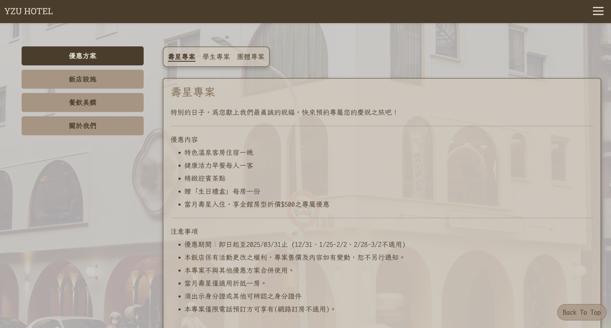
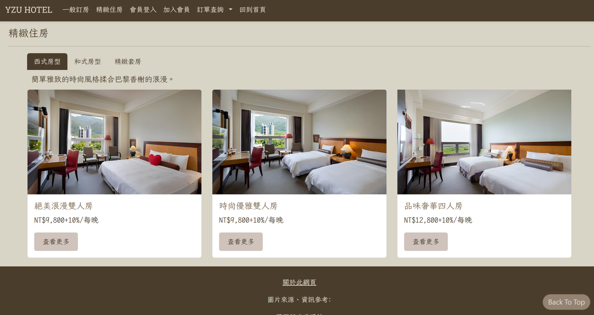
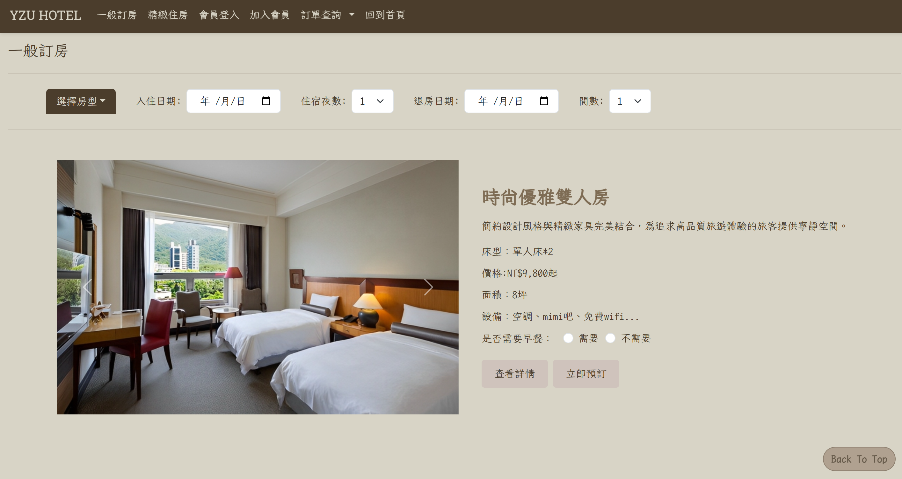

# YZU HOTEL｜飯店主題網頁

## 一、專案簡介

本專案為大一網頁設計課程的個人期末作品，以飯店官方網站為主題，運用 HTML、CSS、Bootstrap 及 JavaScript 製作多頁式網頁。

網站包含飯店首頁、房型介紹、訂房介面及會員相關頁面，希望透過不同頁面的設計與連結，呈現較完整的飯店網站瀏覽流程。

本專案以**前端網頁設計與介面展示**為主，未串接後端資料庫，因此訂房與會員功能不涉及實際資料儲存或交易處理。

## 二、使用技術

- **HTML**：建立網頁內容與頁面結構
- **CSS**：設計網頁樣式、排版與視覺效果
- **Bootstrap**：輔助版面配置與元件設計
- **JavaScript**：實作部分前端互動功能

## 三、主要頁面

### 1. 飯店首頁
呈現飯店主題與網站主要內容，並提供其他頁面的導覽入口。

### 2. 房型介紹
設計多種房型的介紹頁面，搭配圖片展示房間特色，讓使用者能瀏覽不同的住宿選擇。

### 3. 訂房介面
模擬飯店網站的訂房操作介面，呈現使用者選擇住宿資訊的流程。

### 4. 會員相關頁面
製作會員登入、加入會員及忘記密碼等介面，練習表單設計與頁面之間的連結。

## 四、網站展示

**[點此瀏覽 YZU HOTEL 網站](https://hsiyen31.github.io/yzu-hotel/)**

本網站透過 GitHub Pages 發布，可直接於瀏覽器查看網頁成果。
部分截圖畫面展示如下：
### 1. 優惠方案頁面

設計不同優惠方案的切換選單，搭配飯店主題配色與資訊區塊，呈現優惠內容及相關說明。

### 2. 房型介紹頁面

依照房型類別呈現不同住宿選擇，透過圖片卡片展示房間照片、價格及詳細介紹入口。

### 3. 訂房介面

設計房型選擇、入住日期、住宿夜數及房間數量等操作欄位，模擬使用者選擇住宿資訊的流程。

## 五、專案學習與收穫

本專案是我大一時獨立完成的第一個多頁式網站。相較於課堂上的單一頁面練習，我希望能將所學的網頁設計技術整合成較完整的作品，因此以飯店網站為主題，規劃不同房型、訂房介面及會員相關頁面，並嘗試從使用者的角度安排網站內容與操作流程。

透過這次開發，我不僅熟悉了 HTML、CSS、Bootstrap 與 JavaScript 的應用，也開始理解網站設計需要兼顧介面呈現、頁面架構與操作便利性。
在開發過程中我逐漸發現，網頁設計不只是讓畫面呈現出來，還需要考慮不同頁面之間的連結、資訊的安排，以及使用者操作時的便利性。從最初的版面設計到完成整個網站，也讓我累積了獨立規劃與整合多頁式網頁的經驗。

由於當時尚未學習後端程式與資料庫，網站仍以靜態展示為主，但這也讓我產生了進一步學習的動機，希望未來能開發出真正具備資料儲存與管理功能的系統。這份作品因此成為我從前端網頁設計，逐步走向完整系統開發的起點。

---
